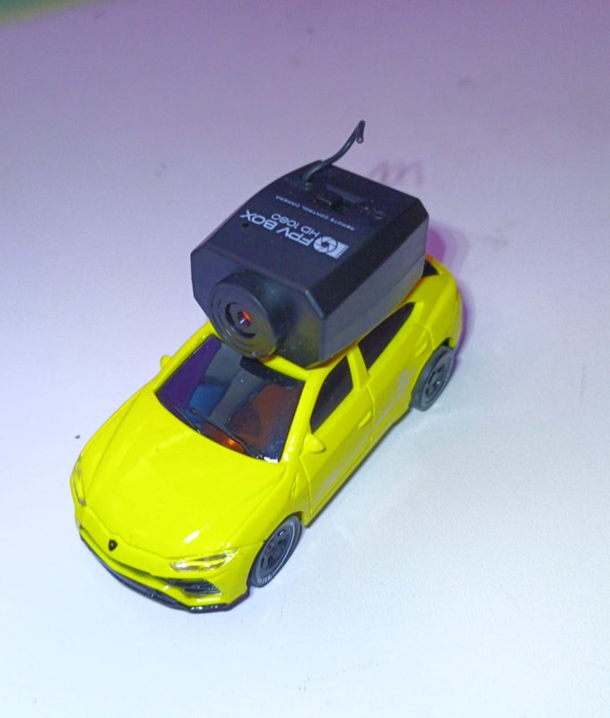
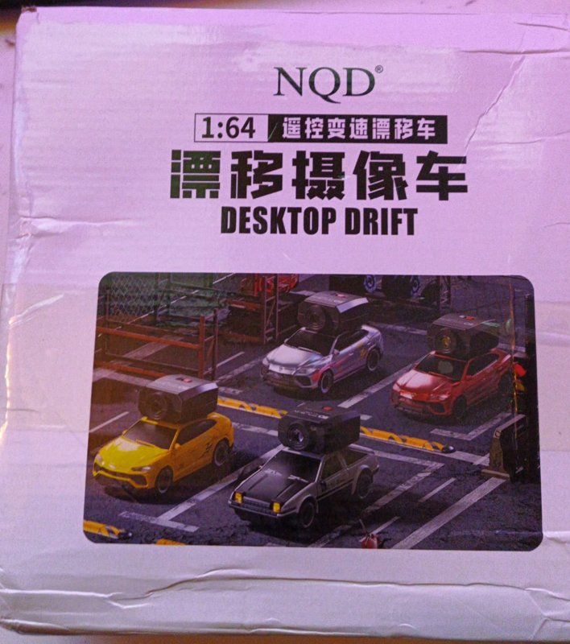
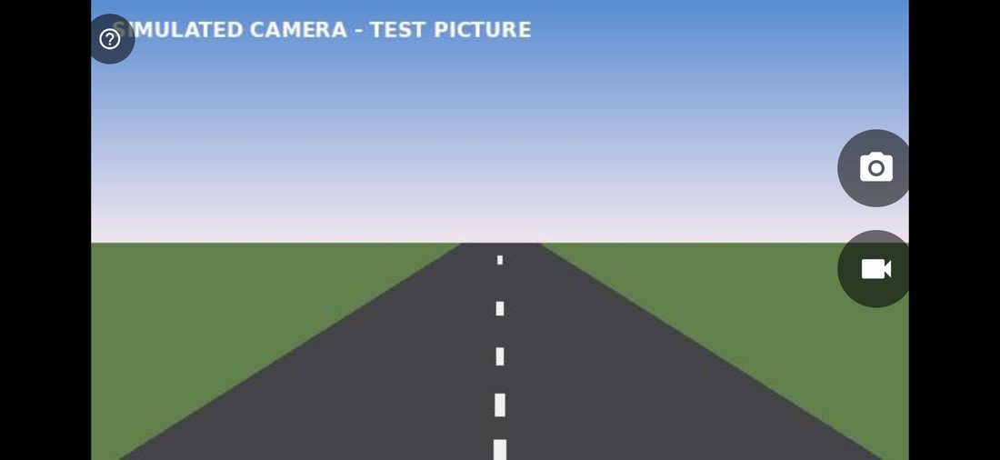
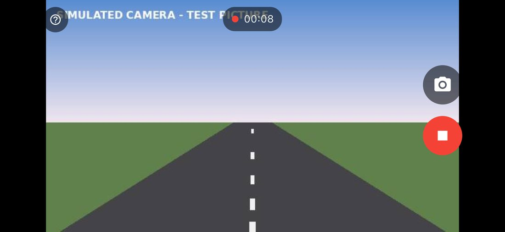
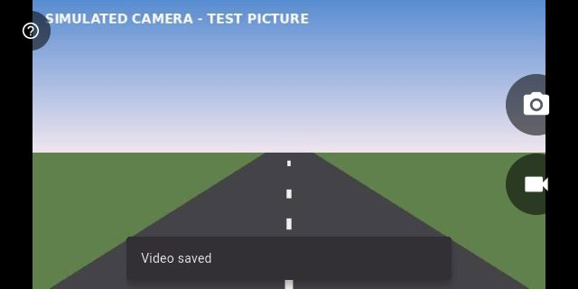
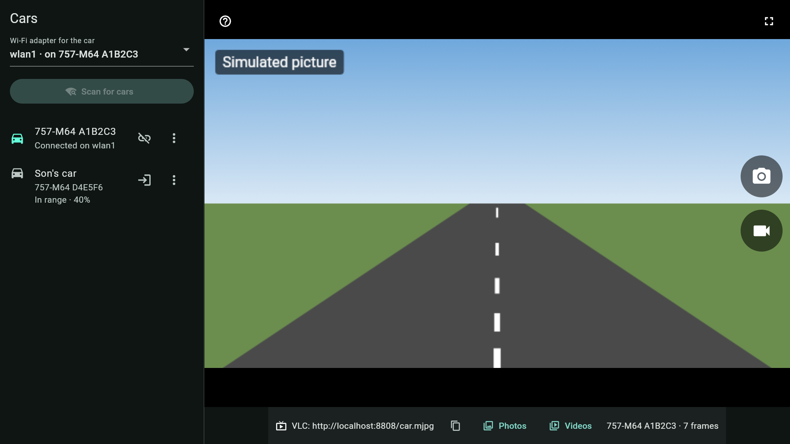
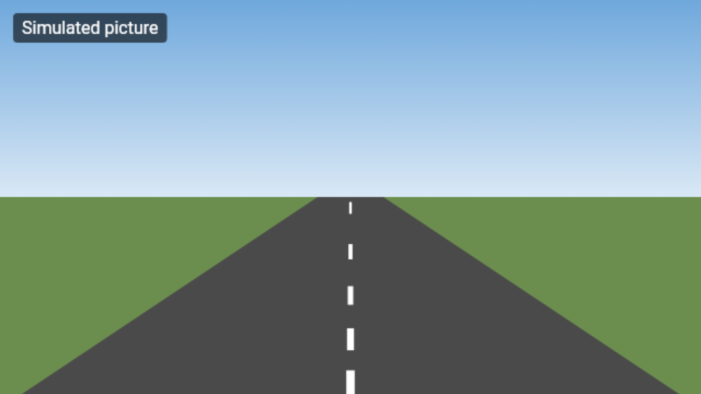

# Car Cam

A video-only viewer for the camera on the **NQD 1:64 Desktop Drift** camera car,
which carries an **FPV BOX HD 1080** camera on its roof. Open the app and the
camera fills the screen. There are no driving controls, accounts or cloud
services. Version 2 can also take photos and record video.

| The car and camera | The box |
| --- | --- |
|  |  |

**[Visit the website](https://awesome-framebuf.github.io/car-cam/)** for the same downloads, more screenshots and videos.

This is an independent project for owners of the car, and isn't affiliated with
or endorsed by the manufacturer.

## Download

Live video, photos and recording on every platform. Pick yours:

<table>
<tr>
<th width="25%"><br>Android</th>
<th width="25%"><br>iPhone</th>
<th width="25%"><br>Windows 10 / 11</th>
<th width="25%"><br>Linux</th>
</tr>
<tr align="center">
<td><br><a href="https://github.com/Awesome-Framebuf/car-cam/releases/download/v2.0.0/CarCam.apk"><b>CarCam.apk</b></a></td>
<td><br><a href="https://github.com/Awesome-Framebuf/car-cam/releases/download/v2.0.0/CarCam-unsigned.ipa"><b>CarCam-unsigned.ipa</b></a></td>
<td><a href="https://github.com/Awesome-Framebuf/car-cam/releases/download/desktop-v2.0.0/CarCamSetup.exe"><b>CarCamSetup.exe</b></a><br><sub>Preview</sub></td>
<td><a href="https://github.com/Awesome-Framebuf/car-cam/releases/download/desktop-v2.0.0/car-cam-linux-x64.tar.gz"><b>car-cam-linux-x64.tar.gz</b></a><br><sub>Preview</sub></td>
</tr>
<tr valign="top">
<td>

1. Scan the code or tap the link.
2. Open `CarCam.apk` and allow installs from your browser if asked.
3. If it refuses, uninstall an older Car Cam first.

</td>
<td>

1. Download `CarCam-unsigned.ipa`.
2. Sign and install it with AltStore or Sideloadly (free Apple ID, re-sign every 7 days).
3. The code only downloads the file: it can't install unsigned.

</td>
<td>

1. Run `CarCamSetup.exe`.
2. If SmartScreen warns (the installer isn't signed): **More info > Run anyway**.
3. Start **Car Cam** from the Start menu. Allow private networks if the firewall asks.

</td>
<td>

1. `tar xzf car-cam-linux-x64.tar.gz`
2. `cd car-cam-linux-x64 && ./install.sh`
3. Start **Car Cam** from the app menu. Needs NetworkManager (standard on Ubuntu).

</td>
</tr>
</table>

The phone apps are in the [Android release](https://github.com/Awesome-Framebuf/car-cam/releases/tag/v2.0.0) and the computer apps
in the [desktop release](https://github.com/Awesome-Framebuf/car-cam/releases/tag/desktop-v2.0.0). The computer apps are a
**preview**: the Linux app has been used with the real car, but the Windows app has
so far only been built and tested in GitHub Actions, not on a real PC. Both
are the camera app only and work with **any Wi-Fi adapter**, including the
one built into your computer.

## Use

1. Turn on the car and wait a few seconds.
2. **Phone:** join the car's Wi-Fi, then open Car Cam. The video starts by itself.
   **Computer:** open Car Cam, press **Scan for cars**, then **Connect**. With one
   Wi-Fi adapter, Car Cam asks first, then switches it to the car (the internet is
   off until you disconnect). With a second adapter, pick that one and your internet
   stays on.
3. Photo and record buttons sit next to the picture. On a computer, F11 or a
   double-click gives full screen, and VLC can show the stream at
   `http://localhost:8808/car.mjpg`.

Stuck? The [connection guide](docs/CONNECTING.md) has screenshots and fixes.

## Screenshots

**Phone:** the real app, captured on the iPhone simulator and the Android 13
emulator. A simulated car provides the picture, so it's a labelled test image
rather than real footage.

| Live video | Recording | Saved to the gallery |
| --- | --- | --- |
|  |  |  |

**Computer: simulated mockups.** These are rendered from the desktop app's real
screens, but the car list is pretend and the picture is a drawn road labelled
"Simulated picture". Real screenshots will replace them.

| Car picker | Live view | Full screen |
| --- | --- | --- |
|  |  |  |

### Optional: BT+AX900 USB dongle (only if you have this exact adapter)

Skip this unless you own the BT+AX900 (AIC8800D80) USB Wi-Fi + Bluetooth dongle
and it doesn't work yet. Car Cam doesn't need it. The
[desktop release](https://github.com/Awesome-Framebuf/car-cam/releases/tag/desktop-v2.0.0) has `WiFi-Dongle-Install.zip` /
`WiFi-Dongle-Install.tar.gz`: driver install scripts for that dongle only
(`Linux/install-aic8800d80.sh` and `Windows\install-aic8800d80.cmd`). The Windows
driver itself belongs to the vendor and isn't included. See its `README.txt`.

## Develop

```sh
flutter test      # includes a fake car that streams over real UDP
flutter analyze
```

Every push to `main` (except docs and site changes) runs the tests, builds both
phone apps in GitHub Actions and replaces the `latest` release. The computer apps
are built from the `desktop` branch and released by pushing a `desktop-v*` tag.

| Path | Purpose |
| --- | --- |
| `lib/protocol/video_channel.dart` | Frame reassembly and acknowledgements |
| `lib/protocol/jpeg_header.dart` | Generates the JPEG header older cameras omit |
| `lib/protocol/car_video_client.dart` | Sockets and timing |
| `lib/capture/capture_service.dart` | Photo and video calls to native code |
| `lib/ui/` | The camera screen and connection guide |
| `lib/main.dart` | Ties the app together |
| `android/`, `ios/Runner/AppDelegate.swift` | Native H.264 recording and saving |
| `integration_test/` | Capture tests run on emulators and simulators |
| `tool/` | Device test scripts, the screenshot renderer and the QR code maker |
| `test/fake_car.dart` | Simulated car used by the tests |
| `docs/CONNECTING.md` | The connection guide |
| `docs/PROTOCOL.md` | The wire protocol |
