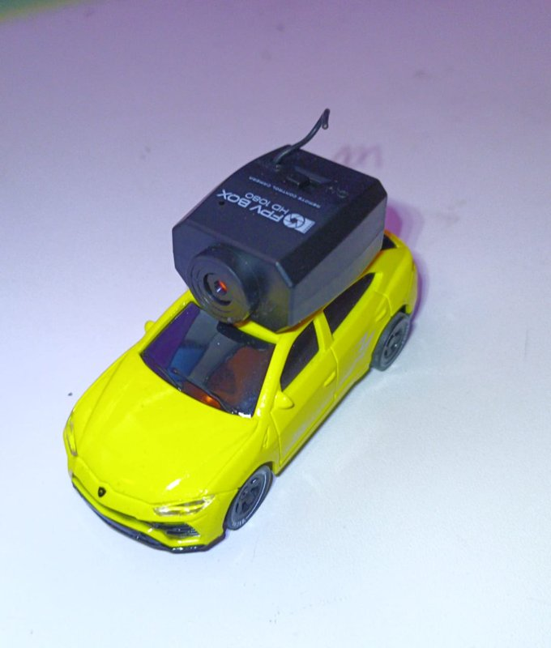
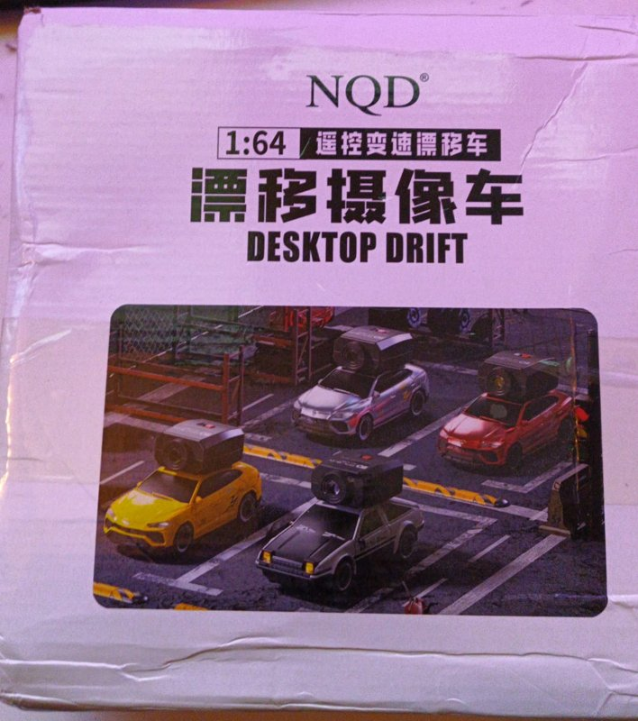
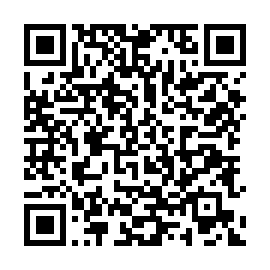
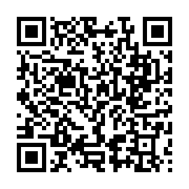
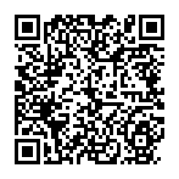
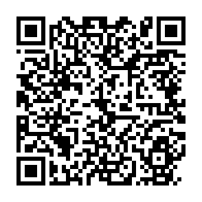
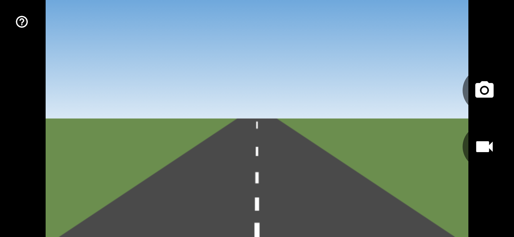

# Car Cam

A video-only viewer for the camera on the **NQD 1:64 Desktop Drift** camera car,
which carries an **FPV BOX HD 1080** camera on its roof. Open the app and the
camera fills the screen. There are no driving controls, accounts or cloud
services. Version 2 can also take photos and record video.

| The car and camera | The box |
| --- | --- |
|  |  |

This is an independent project for owners of the car, and isn't affiliated with
or endorsed by the manufacturer.

## Versions

| | v1 | v2 |
| --- | --- | --- |
| Live video | Yes | Yes |
| Take photos | No | Yes |
| Record video | No | Yes |
| Connection guide in the app | No | Yes |
| Download | [v1.0.0](../../releases/tag/v1.0.0) | [v2.0.0](../../releases/tag/v2.0.0) |

## Install

Scan with your phone's camera to download. Version 2 is the newest.

| | v2.0.0 (photos and video) | v1.0.0 (video only) |
| --- | --- | --- |
| **Android** | <br>[CarCam.apk](../../releases/download/v2.0.0/CarCam.apk) | <br>[CarCam.apk](../../releases/download/v1.0.0/CarCam.apk) |
| **iPhone** | <br>[CarCam-unsigned.ipa](../../releases/download/v2.0.0/CarCam-unsigned.ipa) | <br>[CarCam-unsigned.ipa](../../releases/download/v1.0.0/CarCam-unsigned.ipa) |

The iPhone code only downloads the file: it won't install until it's signed, as
described below.

**Android:** install `CarCam.apk`. If Android refuses to install it over another
version, uninstall the old one first.

**iPhone:** Apple requires apps to be signed, and `CarCam-unsigned.ipa` isn't.
Sign and install it with one of these:

- **AltStore or Sideloadly with a free Apple ID:** the app expires after 7 days
  and needs re-signing.
- **A paid Apple Developer account ($99 a year):** install lasts up to a year,
  and CI could be extended to sign builds and send them to TestFlight.

## Use

Turn on the car, join its Wi-Fi on your phone and open Car Cam. See the
[connection guide](docs/CONNECTING.md) for screenshots and troubleshooting.



## Develop

```sh
flutter test      # includes a fake car that streams over real UDP
flutter analyze
```

Every push to `main` runs the tests, builds both apps in GitHub Actions and
replaces the `latest` release.

| Path | Purpose |
| --- | --- |
| `lib/protocol/video_channel.dart` | Frame reassembly and acknowledgements |
| `lib/protocol/jpeg_header.dart` | Generates the JPEG header older cameras omit |
| `lib/protocol/car_video_client.dart` | Sockets and timing |
| `lib/capture/capture_service.dart` | Photo and video calls to native code |
| `lib/ui/` | The camera screen and connection guide |
| `lib/main.dart` | Ties the app together |
| `android/`, `ios/Runner/AppDelegate.swift` | Native H.264 recording and saving |
| `integration_test/` | Capture tests run on emulators and simulators |
| `tool/` | Device test scripts, the screenshot renderer and the QR code maker |
| `test/fake_car.dart` | Simulated car used by the tests |
| `docs/CONNECTING.md` | The connection guide |
| `docs/PROTOCOL.md` | The wire protocol |
