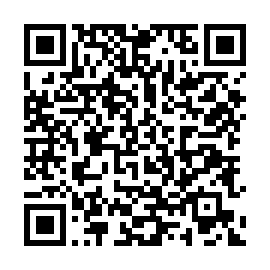
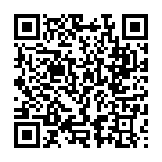
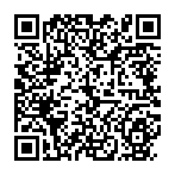
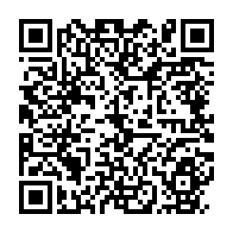
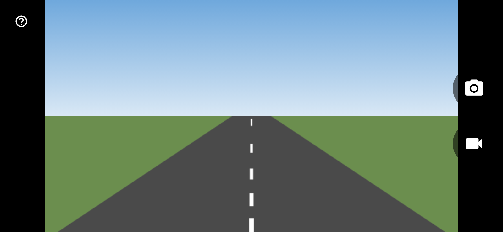
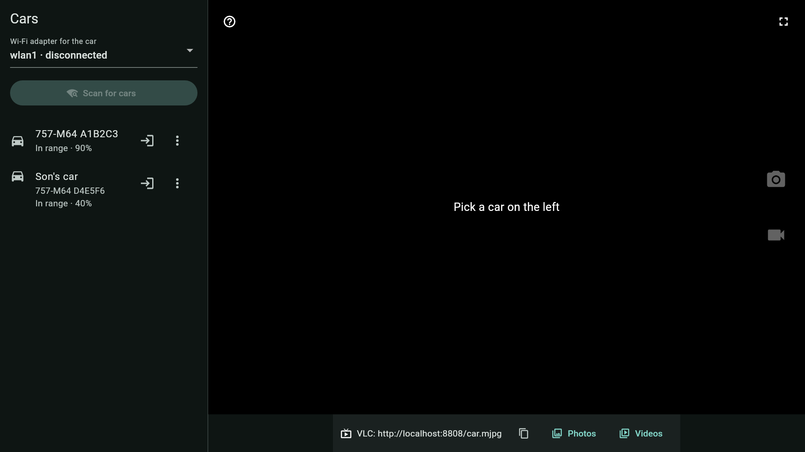

# Car Cam

A video-only viewer for the camera on the **NQD 1:64 Desktop Drift** camera car,
which carries an **FPV BOX HD 1080** camera on its roof. Open the app and the
camera fills the screen. There are no driving controls, accounts or cloud
services. Version 2 can also take photos and record video.

| The car and camera | The box |
| --- | --- |
|  |  |

**[Visit the website](https://awesome-framebuf.github.io/car-cam/)** for downloads, screenshots and videos.

This is an independent project for owners of the car, and isn't affiliated with
or endorsed by the manufacturer.

## Versions

| | v1 | v2 |
| --- | --- | --- |
| Live video | Yes | Yes |
| Take photos | No | Yes |
| Record video | No | Yes |
| Connection guide in the app | No | Yes |
| Download | [v1.0.0](../../releases/tag/v1.0.0) | [v2.0.0](../../releases/tag/v2.0.0) |

## Install

Scan with your phone's camera to download. Version 2 is the newest.

| | v2.0.0 (photos and video) | v1.0.0 (video only) |
| --- | --- | --- |
| **Android** | <br>[CarCam.apk](../../releases/download/v2.0.0/CarCam.apk) | <br>[CarCam.apk](../../releases/download/v1.0.0/CarCam.apk) |
| **iPhone** | <br>[CarCam-unsigned.ipa](../../releases/download/v2.0.0/CarCam-unsigned.ipa) | <br>[CarCam-unsigned.ipa](../../releases/download/v1.0.0/CarCam-unsigned.ipa) |

The iPhone code only downloads the file: it won't install until it's signed, as
described below.

**Android:** install `CarCam.apk`. If Android refuses to install it over another
version, uninstall the old one first.

**iPhone:** Apple requires apps to be signed, and `CarCam-unsigned.ipa` isn't.
Sign and install it with one of these:

- **AltStore or Sideloadly with a free Apple ID:** the app expires after 7 days
  and needs re-signing.
- **A paid Apple Developer account ($99 a year):** install lasts up to a year,
  and CI could be extended to sign builds and send them to TestFlight.

## Use

Turn on the car, join its Wi-Fi on your phone and open Car Cam. See the
[connection guide](docs/CONNECTING.md) for screenshots and troubleshooting.



## Desktop: Linux and Windows (preview)

Download from the **[desktop-v2.0.0 release](https://github.com/Awesome-Framebuf/car-cam/releases/tag/desktop-v2.0.0)**
(a pre-release until Windows is tried on a real PC). Built from the `desktop`
branch by `.github/workflows/desktop.yml`.

Works with **any Wi-Fi adapter**, including the one built into your computer.
The downloads contain the camera app only, no driver.

| Car picker | Live view | Full screen |
| --- | --- | --- |
|  |  |  |

*Mockups for now: rendered from the app's real screens by
`tool/desktop_screenshots_test.dart`, with a pretend car list and a drawn road
labelled "Simulated picture" in place of the camera. Real screenshots will
replace them.*

**Linux** (x64, NetworkManager): download `car-cam-linux-x64.tar.gz`, then

```sh
tar xzf car-cam-linux-x64.tar.gz
cd car-cam-linux-x64
./install.sh            # asks for your password; --uninstall removes it
```

Start **Car Cam** from the app menu, or run `./bundle/car_cam` without installing.

**Windows** (10/11, x64): run `CarCamSetup.exe` (unsigned: SmartScreen > More
info > Run anyway), then start **Car Cam** from the Start menu. Allow private
networks if the firewall asks.

**Use:** switch the car on, press **Scan for cars**, then **Connect**.

- With **one Wi-Fi adapter**, Car Cam asks first, then switches it from your
  home Wi-Fi to the car; the internet is off while you watch and comes back when
  you disconnect or close the app.
- With **two Wi-Fi adapters**, pick the spare one and your internet stays on.
  The car never becomes the internet route (Linux: NetworkManager
  `never-default`; Windows: checked after joining, with a high interface metric
  if needed).
- The car picker scans for networks starting with `757-`, remembers cars, and
  lets you name them.
- Photos go to `Pictures/Car Cam`, videos (Motion-JPEG `.avi`) to `Videos/Car Cam`.
- Full screen: the button on the video, a double-click, or F11; Esc leaves it.
- VLC, OBS or a browser can open the live video at
  `http://localhost:8808/car.mjpg`. If that port is taken the app uses the next
  one and shows the address. A single picture is at `/car.jpg`.
- Tested on a real car on Linux with a second USB Wi-Fi adapter. One-adapter
  mode is tested with simulated networks only. The Windows build is so far only
  built and unit-tested in CI.

### Optional: BT+AX900 USB dongle (only if you have this exact adapter)

Skip this unless you own the BT+AX900 (AIC8800D80) USB Wi-Fi + Bluetooth dongle
and it isn't working yet. Car Cam doesn't need it.

- `WiFi-Dongle-Install.zip` / `.tar.gz` (on the same release): driver install
  scripts for that dongle only, `Linux/install-aic8800d80.sh` and
  `Windows\install-aic8800d80.cmd`. Source: `packaging/wifi-dongle/`. The vendor's
  Windows driver is not included; the script installs it from the dongle's own
  CD drive.

## Develop

```sh
flutter test      # includes a fake car that streams over real UDP
flutter analyze
```

Every push to `main` runs the tests, builds both apps in GitHub Actions and
replaces the `latest` release.

| Path | Purpose |
| --- | --- |
| `lib/protocol/video_channel.dart` | Frame reassembly and acknowledgements |
| `lib/protocol/jpeg_header.dart` | Generates the JPEG header older cameras omit |
| `lib/protocol/car_video_client.dart` | Sockets and timing |
| `lib/capture/capture_service.dart` | Photo and video calls to native code |
| `lib/ui/` | The camera screen and connection guide |
| `lib/main.dart` | Ties the app together |
| `android/`, `ios/Runner/AppDelegate.swift` | Native H.264 recording and saving |
| `integration_test/` | Capture tests run on emulators and simulators |
| `tool/` | Device test scripts, the screenshot renderer and the QR code maker |
| `test/fake_car.dart` | Simulated car used by the tests |
| `docs/CONNECTING.md` | The connection guide |
| `docs/PROTOCOL.md` | The wire protocol |
