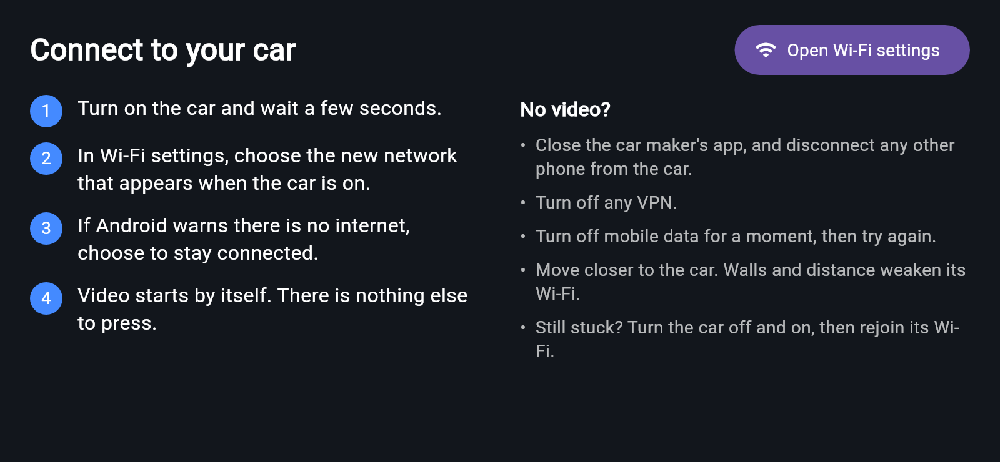
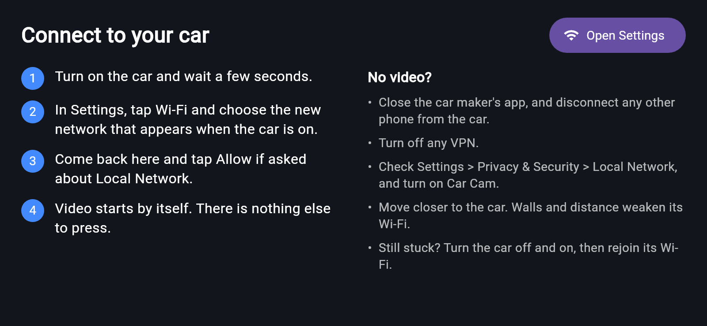
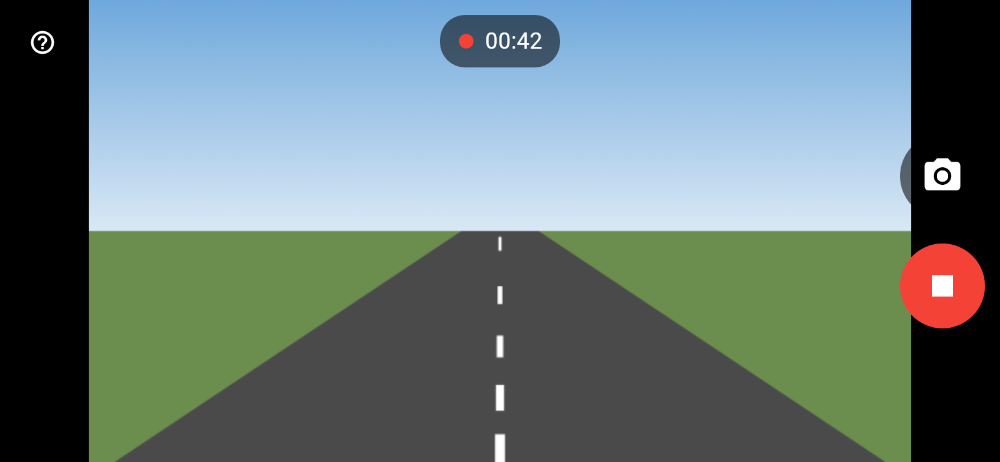
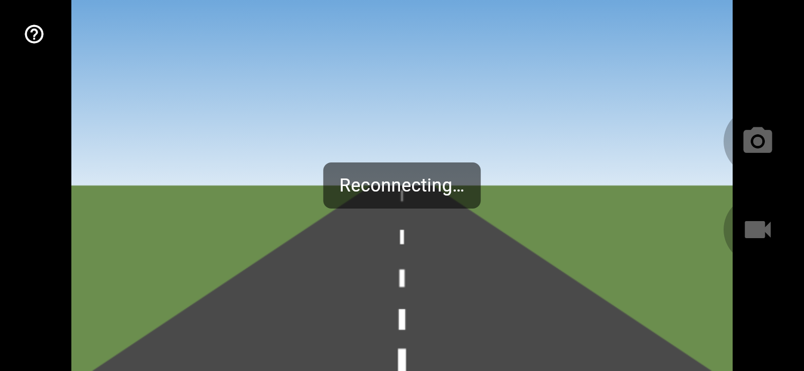

# Connecting to your car

Pictures of the phone are the app's own screens. The camera picture in them is
a drawn stand-in, not real footage.

## The steps

1. **Turn on the car** and wait a few seconds.
2. **Open Car Cam.** Until it finds the car, it shows these steps, with a button
   that opens your settings.
3. **Join the car's Wi-Fi.** Choose the new network that appears when the car is
   on.
4. **Go back to Car Cam.** Video starts by itself.

| Android | iPhone |
| --- | --- |
|  |  |

**Android:** if your phone warns that the network has no internet, choose to
stay connected.

**iPhone:** tap **Allow** when asked about Local Network. The **Open Settings**
button opens Car Cam's page in Settings, so go back to the main Settings list to
find Wi-Fi.

## Taking photos and videos

The buttons on the right take a photo or start recording, and a red timer shows
while you record. If you switch to another app, the video stops and is saved.

Android saves to **Pictures/Car Cam** and **Movies/Car Cam**. iPhone saves to
your photo library. Both ask for permission if they need it: iPhone the first
time you use each button, Android only on version 9 and older.

To see these steps again, tap **?** at the top left.

## What the screen is telling you

| You see | What it means | What to do |
| --- | --- | --- |
| The connection steps | Nothing has come back from the car | Follow the steps and the tips below |
| Starting video… | The car answered, but no full picture has arrived | Wait a few seconds, then move closer |
| Reconnecting… | The video stopped | Move closer, or check the car is still on |
| Another phone is using the car | The car is busy | Close the app on the other phone, or disconnect it from the car's Wi-Fi |

## If there's no video

- Close the car maker's app, and disconnect any other phone from the car.
- Turn off any VPN.
- **Android:** turn off mobile data for a moment, then try again.
- **iPhone:** in Settings > Privacy & Security > Local Network, turn on Car Cam.
- Move closer. Walls and distance weaken the car's Wi-Fi.
- Turn the car off and on, then rejoin its Wi-Fi.
