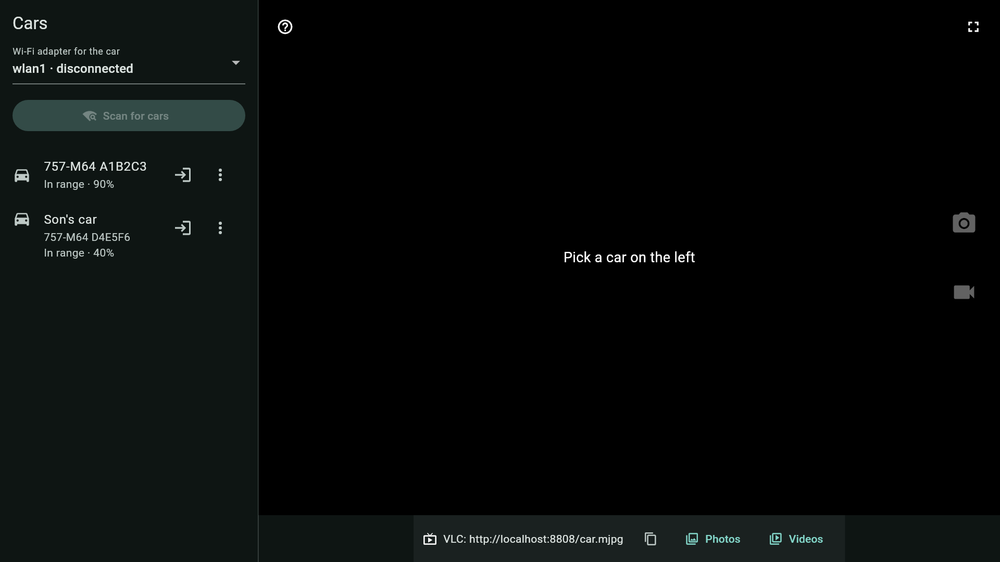
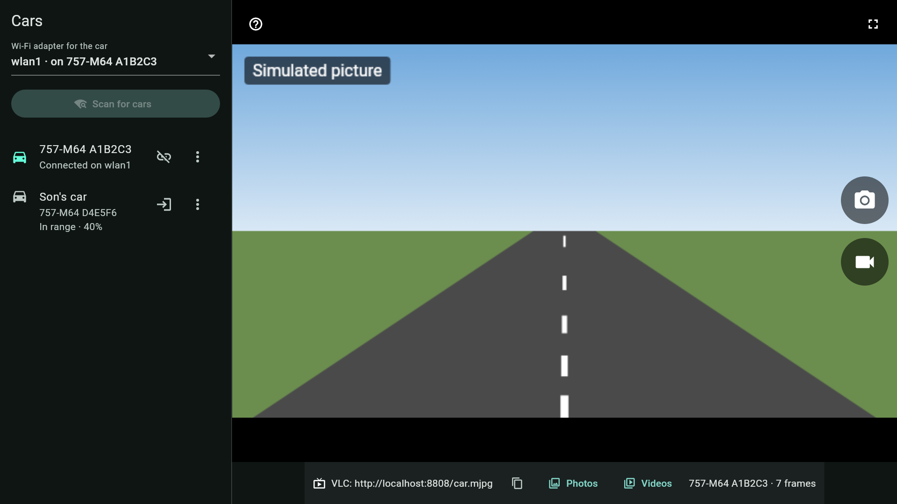
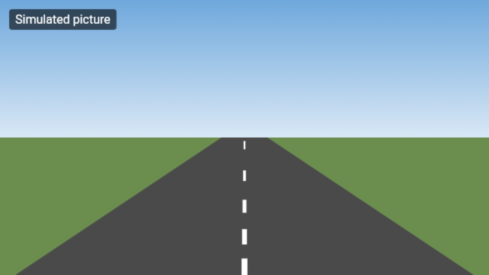

Car Cam for the computer: watch, photograph and record the 757 drift car's camera
on Linux or Windows, and share the live video with VLC or OBS.

**Pre-release:** the Windows build has not yet been tried on a real Windows PC.

Works with **any Wi-Fi adapter**, including the one built into your computer. No
driver and no extra hardware needed.

| File | For |
| --- | --- |
| `car-cam-linux-x64.tar.gz` | Linux (x64, Ubuntu 24.04 tested): the camera app only |
| `CarCamSetup.exe` | Windows 10 / 11 (x64) installer: the camera app only |





*Mockups for now: rendered from the app's real screens, with a pretend car list
and a drawn road labelled "Simulated picture" in place of the camera. Real
screenshots will replace them.*

### Linux

```sh
tar xzf car-cam-linux-x64.tar.gz
cd car-cam-linux-x64
./install.sh            # asks for your password; ./install.sh --uninstall removes it
```
Then start **Car Cam** from the app menu (or run `car-cam`). To try it without
installing: `./bundle/car_cam`. Needs NetworkManager (standard on Ubuntu).

### Windows

1. Run `CarCamSetup.exe`. Windows SmartScreen may warn because the installer is
   not signed: click **More info > Run anyway**. It installs the app only.
2. Start **Car Cam** from the Start menu. If Windows Firewall asks, allow private
   networks.

### Use

1. Switch the car on, press **Scan for cars**, then **Connect** next to the car.
   - **One Wi-Fi adapter** (most computers): Car Cam asks first, then switches it
     from your home Wi-Fi to the car. The internet is off while you watch and
     comes back when you disconnect or close the app.
   - **Two Wi-Fi adapters:** pick the spare one and your internet stays on. The
     car never becomes your internet route.
2. Photo and record buttons are next to the picture. Photos go to
   `Pictures/Car Cam`, videos (`.avi`) to `Videos/Car Cam`.
3. Full screen: the button at the top right of the video, a double-click, or F11.
   Esc leaves it.
4. VLC: Media > Open Network Stream > `http://localhost:8808/car.mjpg`
   (the app shows the address at the bottom if it had to use another port).

### What was tested

- **Linux:** on a real car using a second USB Wi-Fi adapter (live view, photo,
  recording, VLC stream, full screen).
- **One-adapter mode** (switching your only Wi-Fi to the car and back): new in
  this build, tested with simulated networks only, on Linux and Windows.
- **Windows:** built and unit-tested in GitHub Actions only. Not yet tried on a
  real Windows PC with the car.

---

### Optional: BT+AX900 USB dongle (only if you have this exact adapter)

Skip this unless you own the BT+AX900 (AIC8800D80) USB Wi-Fi + Bluetooth dongle
and it doesn't work yet. Car Cam doesn't need it; any Wi-Fi adapter works.

| File | For |
| --- | --- |
| `WiFi-Dongle-Install.zip` / `WiFi-Dongle-Install.tar.gz` | Driver install scripts for that dongle only: `Linux/install-aic8800d80.sh` (builds the community driver) and `Windows\install-aic8800d80.cmd` (installs the driver from the dongle's own CD drive). The Windows driver itself is the vendor's and is not included. See its `README.txt`. |
